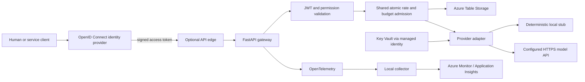

# Odyn Gateway

Odyn Gateway is a Python API service that authenticates callers, applies shared request and spend controls, and forwards bounded chat requests to a configured model provider. It uses FastAPI at the HTTP boundary and keeps authorization, admission, provider handling, and accounting in testable gateway components. Azure is the implemented cloud adapter; the AWS directory preserves the Terraform interface as a documented skeleton.

## Architecture



Azure is the primary adapter because Entra ID, managed identity, Key Vault,
private networking, Table Storage and Azure Monitor fit the service's identity
and operational requirements. The provider interface keeps application policy
independent of Azure-specific storage and credentials. The AWS adapter is an
interface skeleton; it does not provision AWS resources or claim feature
parity.

Key design choices:

- RS256 JWT validation with trusted issuer, audience, time claims and bounded
  JWKS refresh; delegated scopes and application roles are handled separately.
- Continuous per-principal and global token buckets, plus daily token/spend
  budgets. Shared-store transactions reserve capacity atomically across
  replicas; store errors fail closed.
- Conservative usage settlement: an ambiguous upstream result retains its
  reservation, and retries are limited to failures proven to occur before a
  request is sent.
- Fixed HTTPS provider destination, bounded request/response sizes and
  deadlines, redirects disabled, and safe error/telemetry fields.
- A deterministic stub is the default. Live provider mode requires explicit
  configuration and a secret supplied by the deployment secret store.

See [architecture](docs/architecture.md), [threat model](docs/threat-model.md),
[provider portability](docs/provider-portability.md), and the [operational
runbooks](docs/runbooks/).

## Local development

Requirements: Python 3.13, Docker for image checks, and Terraform 1.9.8 for
infrastructure checks. Create an isolated environment and install the hashed
application dependencies:

```sh
python3.13 -m venv .venv
.venv/bin/python -m pip install --require-hashes -r app/requirements.lock
make test
make fmt
make lint
make policy
make compile
make build
make configs
make release
```

`make release` runs local tests, formatting, types, package build, Terraform
validation, policy/configuration checks and repository secret scanning. It does
not contact Azure. Reports and local-only outputs are written under the ignored
`.artifacts/` directory. GitHub Actions runs the same core checks and builds and
scans both runtime images.

For Terraform validation, initialize each root with `-backend=false` and
`-lockfile=readonly` before running `terraform validate`. Never check in state,
plans, real variable files, credentials, or local reports.

## Local chat demo

The optional loopback chat UI uses the configured human OIDC client and sends
requests to the gateway. Start it with:

```sh
.venv/bin/python scripts/local_chat_ui.py
```

Configure the client using the steps in [identity setup](docs/identity-setup.md)
and follow the [local demo guide](docs/local-chat-ui.md). The UI binds to
`127.0.0.1`; it is not a hosted frontend.

## Deployment and secrets

Terraform environments and operator commands are documented in
[`infra/envs/dev/README.md`](infra/envs/dev/README.md),
[`infra/bootstrap/README.md`](infra/bootstrap/README.md), and
[`scripts/README.md`](scripts/README.md). The deployment driver defaults to
read-only preflight and requires an explicitly reviewed saved plan for changes.
Use a least-privileged deployment identity, private state storage, and a
separate runtime managed identity.

The provider key is never a Terraform value or application setting. Store it in
the platform secret manager and configure the runtime to resolve its secret
reference through managed identity. The hidden-input helper
`scripts/set-provider-key.sh` avoids echoing the value. Do not put secrets in
source, command-line arguments, logs, screenshots, or chat.

## Repository layout

```text
app/src/gateway/       gateway domain, HTTP adapter and cloud/provider adapters
app/tests/             unit, integration and contract tests
infra/modules/         shared Terraform contract and cloud adapters
infra/envs/dev/        example Azure environment composition
infra/bootstrap/       remote-state bootstrap configuration
infra/telemetry/       collector image/configuration and workbook
scripts/               local checks, demo and guarded operator tooling
loadtest/              bounded local load scenarios
local-ui/              browser UI assets
docs/                  architecture, security, setup and runbooks
```

The service is designed for bounded workloads. Capacity, shared
partition throughput, provider availability, per-process breaker state, token
revocation latency, cloud egress enforcement, and production service-level
objectives require environment-specific engineering and operational validation.
