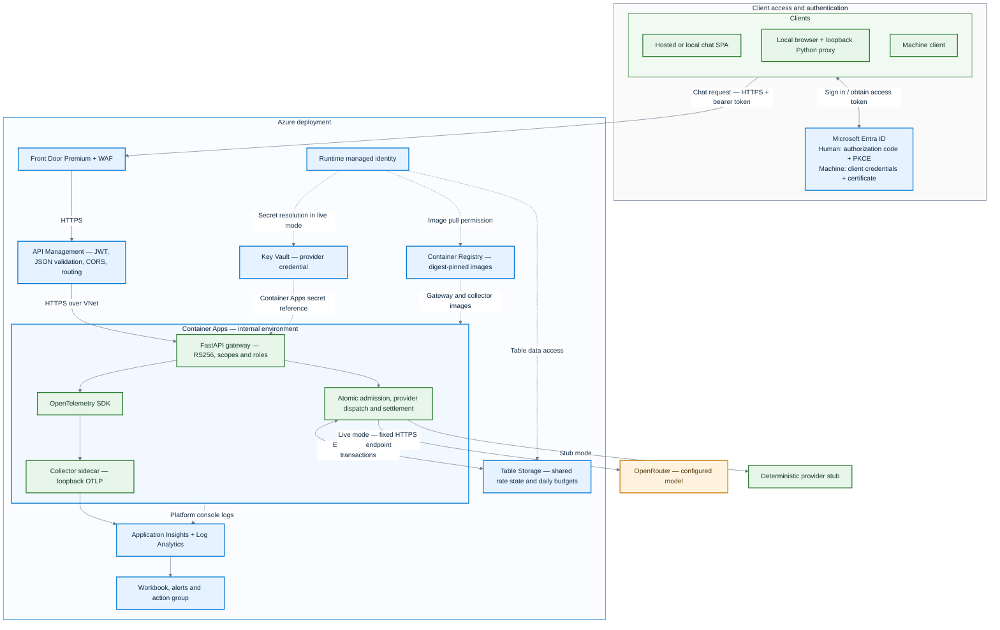

# Odyn Gateway

Odyn Gateway is a Python API service that authenticates callers, applies shared request and spend controls, and forwards bounded chat requests to a configured model provider. It uses FastAPI at the HTTP boundary and keeps authorization, admission, provider handling, and accounting in testable gateway components. Azure is the implemented cloud adapter; the AWS directory preserves the Terraform interface as a documented skeleton.

**Demo status:** Azure service resources were retired on 19 October 2026 to
stop ongoing usage charges. Empty resource groups and scoped identity permissions remain for recovery. Provisioning is disabled. The static client and recorded
demo remain available; the live API must be rebuilt before use. See
[state recovery](docs/state-recovery.md) for encrypted backup and pipeline recovery.

## Architecture

The [architecture review](docs/architecture-review.md) compares both interviewer
briefs and recommends APIM as a single public edge for the updated scope.
The current deployment diagram below retains Front Door/WAF; simplifying that
topology requires a separately tested pipeline migration when redeployed.



**Colors:** blue = Azure-managed services and hosting platform; green = client
and application components we implement, configure or package; amber = external
model provider. The blue Container Apps boundary hosts our green gateway and
collector components. OpenTelemetry is an integrated open-source SDK, and the
collector is a custom-packaged open-source component.

Clients obtain access tokens from Entra and send them to Front Door; Entra is
not a proxy for chat requests. APIM validates JWTs at the edge, and the gateway
validates identity and permissions again before shared admission. Dashed arrows
show deployment, identity, secret and platform-log relationships. The cloud
network boundaries shown here reflect the configured topology; their current
validation limits are documented below.

Azure is the primary adapter because Entra ID, managed identity, Key Vault,
private networking, Table Storage and Azure Monitor fit the service's identity
and operational requirements. The provider interface keeps application policy
independent of Azure-specific storage and credentials. The AWS adapter is an
interface skeleton; it does not provision AWS resources or claim feature
parity.

Key design choices:

- APIM content validation rejects oversized, non-JSON and structurally invalid
  chat requests before forwarding. The application retains complete validation
  and business policy. The schema and policy were deployed through Actions; malformed-body
  behavior has local fixture coverage, with authenticated edge replay still pending; see [edge validation](docs/architecture.md#edge-content-validation).

- RS256 JWT validation with trusted issuer, audience, time claims and bounded
  JWKS refresh; delegated scopes and application roles are handled separately.
- Continuous per-principal and global token buckets, plus daily token/spend
  budgets. Shared-store transactions reserve capacity atomically across
  replicas; store errors fail closed.
- Conservative usage settlement: an ambiguous upstream result retains its
  reservation, and retries are limited to failures proven to occur before a
  request is sent.
- Fixed HTTPS provider destination, bounded request/response sizes and
  deadlines, redirects disabled, and safe error/telemetry fields.
- Hidden provider reasoning is disabled for chat completions so the UI's
  bounded token budget remains available for visible answer text.
- A deterministic stub is the default. Live provider mode requires explicit
  configuration and a secret supplied by the deployment secret store.

For a short tour of the implementation, failure-oriented tests, and lessons
from provider and cloud integration, see [engineering decisions and verification](docs/engineering.md).

See [architecture](docs/architecture.md), [threat model](docs/threat-model.md),
[provider portability](docs/provider-portability.md), and the [operational
runbooks](docs/runbooks/).

## Verification status

The latest Actions deployment passed on 17 October 2026 (IST), on revision
`ca-odyn-gateway-demo10--0000008`. It applied the reviewed saved plan, required a
clean second plan, and checked readiness, public routing, HSTS, authentication
rejection and CORS. Read-only checks on 19 October confirmed the latest revision
is ready, APIM has succeeded, and the request-schema deployment has succeeded.

Earlier authenticated hosted-UI/provider inference, human and machine Entra
sign-in and one controlled alert were demonstrated on 11 October. They were not
repeated by this pipeline rollout. The two-replica load result used a stub
backend; it is not live inference throughput or complete global-budget proof.
These checks demonstrate working paths, not full cloud acceptance. See
[cloud acceptance status](docs/cloud-acceptance-status.md) and
[workflow execution status](docs/workflow-coverage.md#execution-status).

Local revalidation on 19 October 2026 passed 338 gateway/tooling tests, Ruff,
mypy, repository policy and configuration checks. The preceding hosted UI
validation passed 5 configuration tests and the production build. The module
and Azure environment passed Terraform validation after the edge-policy change;
all 4 roots passed the earlier release validation. The 12-job GitHub Actions
suite covers the tested source revision shown in each run; see
[latest main CI](https://github.com/Diwaker-Singh/Odyn-Gateway/actions/workflows/ci.yml?query=branch%3Amain).
The hosted UI Pages workflow is a separate build/deploy check. Cloud and local
evidence artifacts are kept outside the public source tree; the status document
labels what was observed and what is still unproven.

## Local development

Requirements: Python 3.13, Docker for image checks, and Terraform 1.9.8 for
infrastructure checks. Create an isolated environment and install the hashed
application dependencies:

```sh
python3.13 -m venv .venv
.venv/bin/python -m pip install --require-hashes -r app/requirements.lock
make test
make fmt
make lint
make policy
make compile
make build
make configs
make release
```

`make release` runs local tests, formatting, types, package build, Terraform
validation, policy/configuration checks and repository secret scanning. It does
not contact Azure. Reports and local-only outputs are written under the ignored
`.artifacts/` directory. GitHub Actions CI runs the same core checks and builds and
scans both runtime images. Release publication and Azure deployment are separate
manual workflows, not part of pull-request CI.

For Terraform validation, initialize each root with `-backend=false` and
`-lockfile=readonly` before running `terraform validate`. Never check in state,
plans, real variable files, credentials, or local reports.

## Chat demo

The configurable static browser UI is hosted at
[https://diwaker-singh.github.io/Odyn-Gateway/](https://diwaker-singh.github.io/Odyn-Gateway/)
and uses the configured human Entra client to send bounded requests to the
gateway. Watch the [redacted hosted-chat demo on Google Drive](https://drive.google.com/file/d/1j6XgajrV9EkQ4yiZiX0eGQ0NpG35c9hD/view?usp=sharing).
The recording blurs Microsoft account details, connection-setting values and
browser address text. A local Python proxy UI is also available for development;
start it with:

```sh
.venv/bin/python scripts/local_chat_ui.py
```

Configure the client using the steps in [identity setup](docs/identity-setup.md)
and follow the [local demo guide](docs/local-chat-ui.md). It binds to
`127.0.0.1:8400`; the access token remains in the local Python process. The
hosted SPA configuration, local preview and security boundaries are described
in the [hosted chat UI guide](docs/hosted-chat-ui.md). The Entra redirect and
exact-origin APIM preflight are configured, and the authenticated browser-to-chat
path has been smoke-tested against the live provider. Hosting the static files
does not expose the OpenRouter key.

The [workflow coverage guide](docs/workflow-coverage.md) maps operator scripts
to CI, credential-free validation and manual cloud workflows, including the
interactive steps intentionally retained for human sign-in and secret entry.

## Deployment and secrets

Terraform environments and operator commands are documented in
[`infra/envs/dev/README.md`](infra/envs/dev/README.md),
[`infra/bootstrap/README.md`](infra/bootstrap/README.md), and
[`scripts/README.md`](scripts/README.md). The local deployment driver defaults to
read-only preflight and requires an explicitly reviewed saved plan for changes.
Use the [pipeline lifecycle guide](docs/pipeline-lifecycle.md) for complete
bootstrapping, deployment, cleanup and recreation instructions:

| Order | Workflow | Purpose |
|---|---|---|
| Entry point | `lifecycle.yml` | Sequence setup at one main revision, require real component success and retire execution. |
| 0 | `execution.yml` | Create bounded independent private execution and restore configured group-scoped permissions. |
| 1 | `management.yml` | Create durable automation state through ARM; no existing Terraform backend needed. |
| Optional recovery | `state-recovery.yml` | Preserve an encrypted archive; hydrate foundation states after management bootstrap and application state after state-storage bootstrap. Never overwrite an existing blob. |
| 2 | `infrastructure.yml` — bootstrap | Create application state storage using the management backend. |
| 3 | `infrastructure.yml` — registry | Provision the image registry. |
| 4 | `release.yml` | Build, scan, publish and verify digest-pinned images. |
| 5 | `deploy.yml` | Apply an approved saved plan, require a clean second plan and check readiness/public routing. |
| As needed | `operations.yml` | Safe health checks or read-only cleanup inventory. |
| When demo ends | `cleanup.yml` | Preserve encrypted state, then remove the four dedicated deployment groups after protected approval. |

All cloud-mutating workflows default to validation only. Administrative OIDC
trust, scoped roles, private runners, enable flags and environment approvals
must be configured first. Cleanup needs an independent runner outside the
application network. Its full group-deletion mode removes scoped permissions;
cost retirement can instead retain empty permission anchors. See the recovery
guide before choosing a teardown/rebuild strategy.
The static UI uses its separate Pages workflow.

`lifecycle.yml` orchestrates these setup stages and retires temporary execution
on completion. One-time administrator federation, scoped bootstrap authority,
GitHub App setup, environment configuration and provider-secret entry remain
required. See the [recreation contract](docs/pipeline-lifecycle.md#recreation-contract).
Full cold recreation of the complete topology is not yet established by the
component workflow tests. [Independent execution passed its full disposable
creation/probe/retirement test](https://github.com/Diwaker-Singh/Odyn-Gateway/actions/runs/39163453137).

Actual Actions image publication, management storage creation, foundation state-storage provisioning and registry reconciliation passed on 16 October. Application deployment also passed through Actions, including its clean
second plan and public smoke checks. [Disposable cleanup passed end to end](https://github.com/Diwaker-Singh/Odyn-Gateway/actions/runs/39158982129),
including encrypted recovery and absence verification. It used empty application/
registry groups and a real state-storage account. On 19 October, a separate
cost-retirement operation removed the live application, registry, management and
state-storage resources after preserving three encrypted Terraform snapshots.
Empty permission anchors remain; the live API is offline. Future cloud execution
needs an approved window and private runner. Historical billing can arrive later. See [execution
status](docs/workflow-coverage.md#execution-status) for exact run links
and the distinction between helper tests and actual cloud operations.

Cleanup retains durable management storage and external runners, which can still
cost money. To remove management storage too, export and verify state separately
first. Recreate it with the management workflow and restore state before managing
any surviving resources; an empty account is not state recovery. See the
[lifecycle recovery steps](docs/pipeline-lifecycle.md#5-recreate-after-cleanup).
Use a separate runtime managed identity and keep all real configuration private.

The provider key is never supplied as a literal Terraform value or plaintext
configuration entry. Store it in Key Vault; Container Apps resolves the secret
reference through managed identity and injects it into the gateway process as
`OPENROUTER_API_KEY` in live mode. The hidden-input helper
`scripts/set-provider-key.sh` avoids echoing the value. Do not put secrets in
source, command-line arguments, logs, screenshots, or chat.

To remove the dedicated Azure deployment after the demo, follow the
[teardown guide](docs/teardown.md). The teardown script defaults to preview
and requires explicit confirmation before deletion.

## Repository layout

```text
app/src/gateway/        gateway policy, HTTP boundary, storage/provider adapters
app/tests/              unit, integration and contract suites
hosted-ui/              configurable Entra SPA, client tests and Pages build
local-ui/               assets for the loopback Python proxy demo
infra/modules/          shared Terraform interface; Azure and AWS adapters
infra/envs/dev/         Azure environment composition and example variables
infra/bootstrap/        remote-state storage bootstrap
infra/artifacts/        container registry infrastructure
infra/telemetry/        collector image/configuration and workbook
scripts/                local validation, identity demos and operator tooling
loadtest/               bounded local stub load scenario
.github/workflows/      CI, bootstrap, release/deploy, operations, cleanup and Pages
docs/                  architecture, engineering decisions, setup and runbooks
```

The two UI directories serve different purposes: `hosted-ui/` is the static
SPA, while `local-ui/` is served by the loopback Python proxy. Runtime code
lives under `app/src/`; tests and operator scripts are kept outside the runtime
package. Private configuration and generated reports remain ignored.

The service is designed for bounded workloads. Capacity, shared
partition throughput, provider availability, per-process breaker state, token
revocation latency, cloud egress enforcement, and production service-level
objectives require environment-specific engineering and operational validation.
