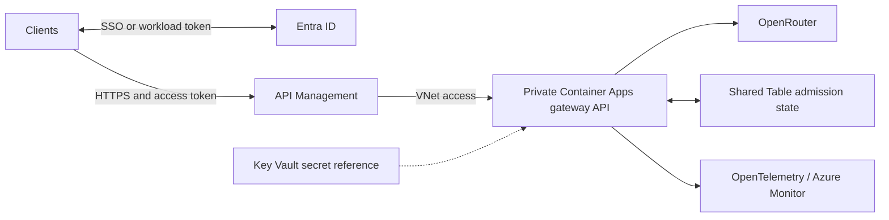

# Architecture review against the interviewer brief

Reviewed 16 October 2026 against both supplied assessment statements. The
updated **Task: Secure API Gateway** explicitly allows a cloud/IaC/architecture
choice and prioritizes reasoning over completeness. It asks for one cloud,
portability notes, a gateway/private backend, SSO and workload tokens, shared
limits, secret management, observability, and one demonstrated alert. The older
statement additionally calls for WAF and a more explicit tracing/portability
contract. The updated guidance changes what needs to be mandatory.

## Recommended simpler topology

Use **one public gateway: APIM**. Keep Container Apps internal, managed identity,
Key Vault, shared Table state and Monitor. Keep the static UI independent of the
backend and obtain its public API URL from deployment configuration. This meets
the updated brief without requiring two public HTTP edge products.

Front Door Premium/WAF is justified when a workload needs those managed
protections, a global edge, origin shielding or an organization requires WAF.
It was justified against the older explicit WAF requirement; the updated brief
does not make it necessary. Treat it as an optional security profile rather
than a prerequisite for every deployment. Removing it is a trade-off: APIM JWT,
rate and schema controls do not replace WAF's attack signatures.

Keep the shared admission store: removing it would weaken global limits across
replicas. Keep application JWT/business validation so the service contract does
not depend on APIM policy implementation. The collector is another candidate
for simplification: a direct maintained Azure Monitor exporter could replace
our custom-built sidecar, but only after trace/metric compatibility, identity,
redaction and dependency tests pass. Do not combine that migration with edge
removal just to reduce the diagram's box count.

The current APIM Developer tier is a non-production demonstration tier. A real
production profile needs an SLA-backed tier with compatible private-network
support, measured capacity, and a reviewed cost model. Merely renaming the
environment to production does not provide that. No Kubernetes, custom IdP,
streaming platform or billing subsystem is needed for this brief.

## Pipeline control for production

Use a stable deployment manifest per environment: topology/security profile,
model/pricing policy, limits, secret names, exact image digests and backend key.
Protect it in source control. Keep secret values in Key Vault and private
operator configuration, and separate publication, foundation/IAM and runtime
identities. Protect main and production environments with independent reviewers.

1. CI validates source, contracts, infrastructure and images without Azure write
   access. Build a release once and promote the verified digests; do not rebuild
   during apply.
2. A foundation pipeline establishes state, registry and scoped IAM. The normal
   app pipeline should not have subscription Owner or broad directory writes.
3. Plan against the selected environment's isolated state, show the full
   intended topology/configuration privately and a sanitized action summary,
   then approve/apply the exact saved plan. Backend, identity, source and input
   bindings must agree between plan and apply.
4. Verify revision readiness, public routing/auth/CORS, backend denial, relevant
   policy cases and telemetry. Preserve the prior image/configuration for an
   explicitly approved rollback. Health alone is insufficient acceptance.
5. Handle topology removals through a dedicated protected migration operation,
   with a cutover/rollback plan. Existing normal deployment jobs reject deletes
   and replacements; that guard must not be bypassed through an ad hoc local
   command. Teardown is a separate deliberate lifecycle operation.

The current workflows demonstrate these controls for the assessment environment;
there is not yet an isolated, configured production environment or promotion
pipeline. A public demo is not production qualification.

## Safe migration of the existing demo

### Cost choice for a future deployment

| Option | Illustrative base-fee saving | Trade-off |
|---|---|---|
| Front Door Standard instead of Premium | Microsoft's comparison lists USD 35 versus USD 330/month: USD 295/month, about 89%, before usage and agreement-specific pricing. | Standard supports custom WAF rules, but not the managed rule set configured here or Private Link origins. It is a different security profile, not a drop-in SKU edit. |
| APIM as the only public edge | Removes Front Door's base and traffic meters entirely. | Requires the reviewed origin/network/policy/client changes above and fresh acceptance testing. |
| Delete an idle assessment deployment | Removes its active resource usage once deletion completes. | The demo is offline until rebuilt; historical charges can still arrive later. |

Sources: [Microsoft's illustrative tier pricing](https://learn.microsoft.com/en-us/azure/frontdoor/understanding-pricing)
and [Front Door origin security](https://learn.microsoft.com/en-us/azure/frontdoor/origin-security).
No lower-cost topology is claimed implemented or tested. For an idle assessment,
retirement is preferable to paying for a smaller always-on edge. Disabling
pipeline flags prevents provisioning; it does not stop billing for resources
that already exist.

The running deployment still uses Front Door/WAF. This review does not remove
it or claim the simpler topology has been implemented. Before switching:

- Add and test an explicit topology profile, preserving the current profile
  for existing state and using Terraform moved blocks for address changes.
- Confirm APIM's direct public gateway is the intended sole edge, update its
  NSG and origin-header policy together, and preserve private ACA ingress.
- Generate a reviewed migration plan. Publish APIM's URL to the static client,
  validate SSO/chat and network boundaries, then retire Front Door resources
  through the protected migration pipeline.
- Recheck cost, clean second plan, alert routing and rollback behavior.

This makes the solution smaller by removing an unnecessary edge layer, while
keeping the controls that actually satisfy the assessment. Migration must be
observable and reversible through configuration before the old edge is deleted.
