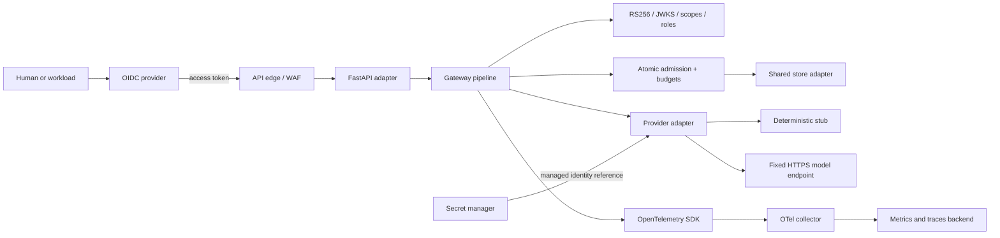

# Architecture

Odyn Gateway separates protocol handling from gateway policy. The FastAPI
adapter validates and bounds HTTP input, then delegates to a shared gateway
pipeline. The pipeline authenticates, authorizes, admits, dispatches, settles
usage, and emits telemetry. Provider and storage adapters sit behind narrow
interfaces so the core remains testable without cloud credentials.

## Request path

1. The identity provider issues an access token for the gateway API. Human
   clients use authorization code with PKCE; confidential clients use a
   certificate assertion.
2. The HTTP adapter enforces a streamed body limit and returns health and
   readiness responses without dispatching to the model provider.
3. The gateway validates signature algorithm, issuer, audience and time claims,
   then checks the delegated scope or application role. Caller-supplied
   identity headers are ignored.
4. Schema validation enforces the model allowlist and input/output bounds.
   Admission atomically reserves rate, concurrency and spend capacity before
   any provider call.
5. The provider adapter sends one bounded request to a fixed HTTPS host. It
   follows no redirects and retries only when transport proves the request was
   not sent.
6. Settlement records returned usage or retains a conservative reservation
   when the upstream outcome is ambiguous. The response uses a stable safe
   error envelope.
7. The gateway emits allowlisted metrics and trace fields. Prompts,
   completions, bearer tokens, provider credentials and raw identity claims
   are excluded.

## Component boundaries

- `api.py` and `web.py`: FastAPI/ASGI input limits, routing and response
  adaptation.
- `auth.py` and `jwks.py`: token validation, trusted key refresh, and caller
  permission classification.
- `schema.py`: request and model policy.
- `admission.py`, `limiter.py`, `budget.py`, and `table_store.py`: reservation,
  rate and budget rules with local and Azure-backed stores.
- `provider.py` and `upstream.py`: fixed-destination provider transport,
  response bounds, retry/deadline behavior and usage parsing.
- `resilience.py`: bounded per-process circuit breaker.
- `otel.py` and `telemetry.py`: safe metrics, spans and event attributes.
- `infra/modules/llm-gateway/`: cloud-specific resources behind a shared
  Terraform interface.

## Design trade-offs

Azure is the implemented cloud target. Entra, managed identity, Key Vault,
Table Storage and Azure Monitor provide an integrated identity, secret, shared
state and telemetry path. The AWS adapter preserves the module interface but
does not create resources or claim equivalent behavior.

The shared global admission row simplifies atomic enforcement across replicas
but limits write throughput. Rate state is continuous; daily budget partitions
are separate. The breaker is process-local, so it does not coordinate across
replicas. The current design does not provide streaming, multi-region failover,
immediate revocation of issued bearer tokens, or a billing ledger.

The deterministic provider stub is the safe default for local development and
tests. Live mode uses a deployment-provided secret reference and explicit
model/pricing configuration. Cloud network policy, capacity, availability and
security guarantees must be validated for each deployment; configuration
alone does not prove effective enforcement.
