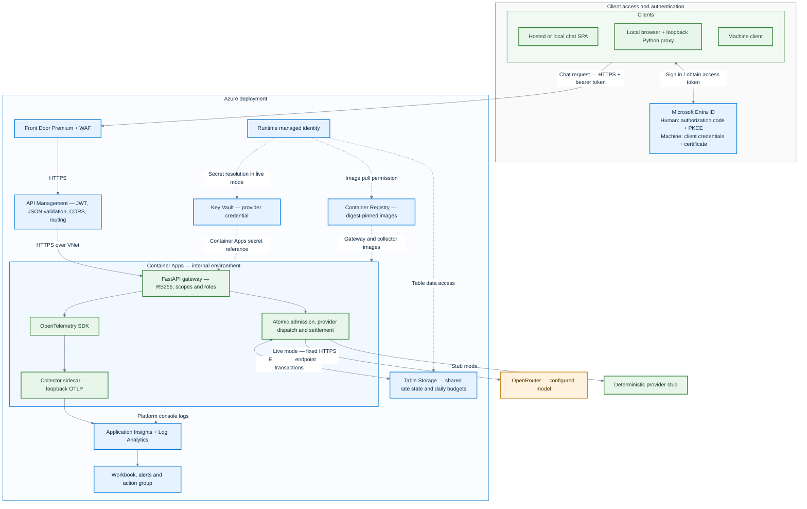

# Architecture

Odyn Gateway separates protocol handling from gateway policy. The FastAPI
adapter validates and bounds HTTP input, then delegates to a shared gateway
pipeline. The pipeline authenticates, authorizes, admits, dispatches, settles
usage, and emits telemetry. Provider and storage adapters sit behind narrow
interfaces so the core remains testable without cloud credentials.

**Colors:** blue = Azure-managed services and hosting platform; green = client
and application components we implement, configure or package; amber = external
model provider. The blue Container Apps boundary hosts our green gateway and
collector components. OpenTelemetry is an integrated open-source SDK, and the
collector is a custom-packaged open-source component.

## Request path

1. The identity provider issues an access token for the gateway API. Human
   clients use authorization code with PKCE; confidential clients use a
   certificate assertion.
2. The HTTP adapter enforces a streamed body limit and returns health and
   readiness responses without dispatching to the model provider.
3. The gateway validates signature algorithm, issuer, audience and time claims,
   then checks the delegated scope or application role. Caller-supplied
   identity headers are ignored.
4. Schema validation enforces the model allowlist and input/output bounds.
   Admission atomically reserves rate, token and spend capacity before
   any provider call.
5. The provider adapter sends one bounded request to a fixed HTTPS host. It
   follows no redirects and retries only when transport proves the request was
   not sent.
6. Settlement records returned usage or retains a conservative reservation
   when the upstream outcome is ambiguous. The response uses a stable safe
   error envelope.
7. The gateway emits allowlisted metrics and trace fields. Prompts,
   completions, bearer tokens, provider credentials and raw identity claims
   are excluded.

## Component boundaries

- `api.py` and `web.py`: FastAPI/ASGI input limits, routing and response
  adaptation.
- `auth.py` and `jwks.py`: token validation, trusted key refresh, and caller
  permission classification.
- `schema.py`: request and model policy.
- `admission.py`, `limiter.py`, `budget.py`, and `table_store.py`: reservation,
  rate and budget rules with local and Azure-backed stores.
- `provider.py` and `upstream.py`: fixed-destination provider transport,
  response bounds, retry/deadline behavior and usage parsing.
- `resilience.py`: bounded per-process circuit breaker.
- `otel.py` and `telemetry.py`: safe metrics, spans and event attributes.
- `infra/modules/llm-gateway/`: cloud-specific resources behind a shared
  Terraform interface.

## Design trade-offs

Azure is the implemented cloud target. Entra, managed identity, Key Vault,
Table Storage and Azure Monitor provide an integrated identity, secret, shared
state and telemetry path. The AWS adapter preserves the module interface but
does not create resources or claim equivalent behavior.

The shared global admission row simplifies atomic enforcement across replicas
but limits write throughput. Rate state is continuous; daily budget partitions
are separate. The breaker is process-local, so it does not coordinate across
replicas. The current design does not provide streaming, multi-region failover,
immediate revocation of issued bearer tokens, or a billing ledger.

The deterministic provider stub is the safe default for local development and
tests. Live mode uses a deployment-provided secret reference and explicit
model/pricing configuration. Cloud network policy, capacity, availability and
security guarantees must be validated for each deployment; configuration
alone does not prove effective enforcement.

The current runtime has no explicit in-flight request semaphore. Rate limits
and bounded deadlines reduce exposure but do not substitute for a concurrency
limit. A production rollout should define a measured in-flight cap, durable
reservation retention/reconciliation, and partition capacity before raising
traffic limits. Terminal reservation rows are retained for idempotence; no
automated retention worker is implemented. Cleanup must preserve the retry and
settlement window and must never refund an outcome that may have been billed.

## Delivery boundary

Application CI verifies source without Azure credentials. Separate, manually
triggered release and deployment workflows use dedicated federated identities,
verified image digests, and protected GitHub environments. The runtime identity
has pull/data/secret permissions separately from automation. These workflows
are disabled until configured and have not been cloud-tested; see
[delivery setup](delivery.md).

## Edge content validation

The repository policy now validates only `POST /v1/chat`, after origin/JWT
checks and the coarse edge throttle. Health, readiness and CORS preflight do
not require a chat body. This source change has **not been deployed or tested
in APIM**; the last cloud verification predates it.

APIM requires `application/json` (case-insensitive, with charset parameters
accepted), enforces the configured `max_body_bytes`, and checks the small
service-level schema in `chat-request.schema.json`. It requires an object with
`model`, `messages` and integer `max_tokens`, typed message fields and no extra
properties. The application independently validates actual body bytes and the
complete request, then enforces supported roles, model allowlists, token limits,
permissions and shared budgets. The edge schema deliberately has no model enum
or deployment-specific token ceiling.

A size-only validation stage maps oversized bodies to 413; unsupported media
types return 415; malformed JSON or structural schema failures return 400.
Application semantic failures continue to return 422. Both layers use the
safe error envelope and request ID; raw validation details are not returned
or explicitly traced by the policy. Missing/broken deployed schemas can also
cause validation failure, so operators must investigate unexpected 400 spikes
rather than assuming every rejection is a caller mistake.

AzureRM 4.14.0 has no service-level schema resource, so a small incremental ARM
deployment creates the JSON schema before the API policy references it. The
shared byte limit is constrained to APIM's supported 1-byte through 4-MiB range.
The edge size check follows APIM's transport handling; the application retains
its streamed-body bound for requests whose declared length is absent or wrong.

Local contract tests check scope, ordering, size wiring, dependency order and
safe errors. `make configs` uses the locked scan environment's JSON Schema
validator against shared positive/negative fixtures; `make test` checks those
fixtures against application validation. These checks do not emulate the APIM
policy engine. After an approved rollout, verify valid chat, malformed JSON,
wrong types, missing/extra fields, charset content types, oversized/chunked
bodies, preflight and readiness. Verify rejected requests never reach the
backend, and measure validation overhead with a stub backend before raising
traffic limits.

Operational checks and troubleshooting: [request-validation runbook](runbooks/request-validation.md).

References: [Microsoft validate-content policy](https://learn.microsoft.com/en-us/azure/api-management/validate-content-policy),
[service-level JSON schema resource](https://learn.microsoft.com/en-us/rest/api/apimanagement/global-schema/create-or-update?view=rest-apimanagement-2024-05-01).
