# Release and deployment

The repository separates verification, image publication, and deployment:

```mermaid
flowchart LR
    Source[Main commit] --> CI[ci.yml: tests and security checks]
    CI --> Release[release.yml: manual build and scan]
    Release --> Approval[azure-release approval]
    Approval --> ACR[Publish and verify ACR digests]
    ACR --> Receipt[Release receipt: source and exact digests]
    Receipt --> Plan[deploy.yml: private Terraform plan]
    Plan --> Review[Plan summary and azure-deploy approval]
    Review --> Apply[Apply the same saved plan]
    Apply --> Health[Revision readiness and health smoke check]
```

The workflows default to credential-free validation. Real cloud jobs require
explicit enable flags, scoped OIDC identities, network access and protected
environments. On 16 October 2026, actual image publication succeeded at
[run 38946401639](https://github.com/Diwaker-Singh/Odyn-Gateway/actions/runs/38946401639).
Application plan/apply also passed through Actions: [run 38947234780](https://github.com/Diwaker-Singh/Odyn-Gateway/actions/runs/38947234780),
using source `7bca5c1`, including the clean second plan, revision readiness,
public routing, HSTS, authentication rejection and CORS. It did not send a live
inference request or repeat load/alert acceptance. Passing helper tests alone
is not deployment proof.
The temporary private test VM, disk, NIC and public IP were removed after the
test window. Recovery storage and network scaffolding remain; disposable cleanup
revalidation is pending. Reestablish approved private execution and enable flags
before future cloud jobs.

For one-time application state storage and registry provisioning, use the
[foundation workflow](foundation-deployment.md) before these application steps.
It uses a separate management backend and foundation identity.

Each manual delivery workflow now defaults to `validation_only=true`, running
credential-free helper checks and skipping Azure jobs. Real publication or apply
requires explicitly choosing `validation_only=false`, completed configuration,
and protected environment approval. See [workflow coverage](workflow-coverage.md)
for script-by-script execution and current setup requirements.

## Workflow boundaries

| File | Trigger and responsibility |
|---|---|
| `.github/workflows/management.yml` | Manual ARM bootstrap of durable automation storage; separate administrative identity and approval. |
| `.github/workflows/cleanup.yml` | Manual encrypted recovery and protected resource-group deletion; disabled by default. |
| `.github/workflows/infrastructure.yml` | Manual bootstrap or registry plan/apply, encrypted saved plan and protected foundation approval; disabled until configured. |
| `.github/workflows/ci.yml` | Push/PR checks, package builds, image builds and vulnerability scans. No Azure login. |
| `.github/workflows/release.yml` | Manual dispatch on main after successful push CI for the same commit. Builds amd64 images, scans them, then publishes through a protected environment. |
| `.github/workflows/deploy.yml` | Manual dispatch on main with a successful release run ID for the same commit. Plans, presents resource actions and the saved-plan hash, then applies after environment approval. |
| `.github/workflows/pages.yml` | Separate static frontend build and GitHub Pages deployment. |

`scripts/delivery.py` verifies release provenance, constrains plans to the
configured application group, and encrypts/decrypts saved plans. The existing
`scripts/deploy.py` remains an interactive operator path with its historical
Owner-role requirement. Do not grant the automation subscription Owner merely
to satisfy that local driver: the workflow does not invoke it.

Release uploads the scanned Docker archives between jobs. Publication loads
those same bytes, checks architecture/non-root metadata and image IDs, and
uses a unique source/run/attempt tag. A tag collision stops publication. Tags
remain mutable: after push, the script obtains the ACR manifest digest, pulls
that exact reference, and checks its image ID against the scanned artifact.
Terraform uses the digest reference, not the tag. A partial publication can
leave an image in ACR; investigate and clean it up instead of assuming rollback.

## Configure authentication and approvals

Configure these prerequisites through a deliberate administrative setup.
Use the exact OIDC subject observed in Azure Login: this repository emits the
immutable owner/repository-ID form shown below. Other repositories may use the
older `repo:OWNER/REPO:environment:ENV` form. Never guess or broaden the trust
pattern to work around a mismatch.

1. Create a dedicated Azure publication identity with `AcrPush` and registry metadata `Reader` scoped to the
   intended registry. For this module use a registry whose permission mode
   supports that role; ABAC-enabled registries need the appropriate repository
   roles and a reviewed workflow adjustment.
2. Create a separate deployment identity. Scope infrastructure permissions to
   the dedicated application group, Blob Data Contributor to state storage,
   and only the additional identity/role-assignment permissions Terraform
   requires. Role assignment changes require carefully scoped authorization;
   Contributor alone cannot create role assignments. Existing registry and
   state-storage infrastructure must be bootstrapped separately.
3. Create GitHub environments `azure-release`, `azure-plan`, and `azure-deploy`.
   Restrict them to main and configure required reviewers. Prevent approval
   bypass/self-approval where suitable reviewers are available. Apply approval
   occurs **after** the plan summary exists; initial plan access can have a
   separate reviewer gate. Merely naming an environment in YAML does not set
   protection rules.
4. Configure Azure federated credentials with issuer
   `https://token.actions.githubusercontent.com`, audience
   `api://AzureADTokenExchange`, and exact subjects
   `repo:OWNER@OWNER_ID/REPO@REPO_ID:environment:azure-release`,
   `repo:OWNER@OWNER_ID/REPO@REPO_ID:environment:azure-plan`, and
   `repo:OWNER@OWNER_ID/REPO@REPO_ID:environment:azure-deploy`. The release subject trusts the
   publication identity; plan and apply trust the same deployment identity.
   Environment branch protection is necessary because these subjects identify
   environments rather than branches.
5. Configure a dedicated **ephemeral** Linux amd64 runner labeled `odyn-azure`
   with connectivity to the private Azure endpoints and permitted state-storage
   access. Include `unzip`/`zstd`, Azure CLI, GitHub CLI and the runtime libraries
   needed by the setup actions. Provision Azure CLI, GitHub CLI, and the tools needed by the setup
   actions. Do not expose this runner to PR jobs or share it with untrusted
   repositories. Hosted release runners access ACR's authenticated endpoint;
   private ACR publication requires a separately reviewed runner arrangement.
6. Set the variables and secrets below, validate all environment protections,
   and only then enable `AZURE_DELIVERY_ENABLED=true`.

GitHub OIDC supplies a short-lived workload identity, and Azure RBAC determines
its access. It is separate from chat-user SSO and the runtime managed identity.
No Azure client password is stored in GitHub.

## Configuration

Repository variables (same destination for both deployment jobs):

- `AZURE_SUBSCRIPTION_ID`, `AZURE_TENANT_ID`, `AZURE_RESOURCE_GROUP`.
- `ACR_NAME`, `ACR_LOGIN_SERVER` (for example `registry.azurecr.io`).
- `HEALTH_URL`: exact trusted Front Door HTTPS `/v1/healthz` URL.
- `AZURE_DELIVERY_ENABLED`: leave unset/false until setup is complete.

Set environment variable `AZURE_CLIENT_ID` on `azure-release` to the publication
identity client ID. Set it on **both** `azure-plan` and `azure-deploy` to the same
deployment identity client ID. Other identifiers above belong at repository
scope so both jobs use the same destination.

Set the following secrets identically on `azure-plan` and `azure-deploy`:

- `APPLICATION_TFVARS_JSON`: complete environment variables for the application
  Terraform root. Include explicit subscription/tenant, model/pricing, network,
  identity and operational configuration. `subscription_id` and `tenant_id`
  explicitly bind the Terraform provider destination. `vault_purge_protection`
  defaults to true; the existing disposable assessment must explicitly retain
  its current false value unless enabling irreversible protection is intended.
  Image inputs are replaced with the
  verified release digests. Include only the Key Vault secret **name**, never
  an OpenRouter key or any other credential value.
- `TF_BACKEND_JSON`: Terraform backend configuration as JSON, including storage
  account, resource group, container, key, and `use_azuread_auth: true`. Account
  keys, SAS tokens and client passwords are rejected. The runner must actually
  reach the backend; do not weaken its firewall to accommodate hosted runners.
- `PLAN_ENCRYPTION_KEY`: a base64-encoded, cryptographically random 32-byte key
  used solely for saved-plan artifact encryption. Generate locally with
  `openssl rand -base64 32` and store privately in both environments. This is
  an artifact encryption key, not an Azure authentication secret.

The plan can contain sensitive state and variables. Only an AES-GCM encrypted
bundle is uploaded, with one-day artifact retention. The readable job summary
contains resource addresses/actions and the plan/source hashes, not attribute
values. Approval must consider the intended configuration and costs as well as
these actions; the summary is not a complete semantic diff. An authorized
operator needing the complete diff must inspect the plan privately using the
local tooling. Never publish `terraform show -json` output as an artifact.

## Run a release and deployment

1. Merge reviewed code into main and wait for the exact commit's push CI to pass.
2. Manually run `release-images` on main. Review/approve `azure-release` and
   retain its `verified-release` receipt and run ID. Artifact retention is not
   ACR image retention: registry storage continues until images/registry are
   removed. Set a registry lifecycle policy suitable for the environment.
3. Run `deploy-azure` on that same main commit with `release_run_id`. If main
   changed, release the new commit first. The workflow rejects other workflows,
   unsuccessful releases, different commits, and non-main releases.
4. Review the plan job summary before approving `azure-deploy`. Deletes and
   replacements are rejected; handle those through a separately reviewed local
   operator change. Approval also authorizes the runtime cost of the change.
5. Apply decrypts the original saved plan and verifies its hash, source,
   destination, federated principal and private inputs. Plans expire after one
   hour; an expired plan requires a new dispatch/review. It never silently
   replans after approval. Terraform state locking protects against concurrent
   changes; external changes may make the saved plan stale and cause failure.
6. For the new content-validation policy, ensure the saved plan includes the
   schema deployment and policy update. After apply, perform the
   [request-validation checks](runbooks/request-validation.md); health alone
   cannot prove that malformed chat traffic is rejected before the backend.
7. Inspect readiness/health results. This smoke check performs no chat/provider
   request and does not establish full cloud acceptance, global budgets, alert
   delivery, or inference throughput. Use targeted acceptance checks separately.

Both workflows serialize their own operations and never cancel an active apply.
The workflows do not bootstrap resources, create an OpenRouter secret, run paid
load tests, automatically roll back, or tear down the deployment. A partial apply
or health failure requires investigation and a new reviewed plan. Use the
[teardown guide](teardown.md) when the deployment is no longer required.

Private temporary files are removed in `always()` steps, but a killed runner
can retain them; ephemeral runner destruction is part of the security boundary.
The actions use version tags consistent with existing CI; production automation
should additionally pin reviewed action commits and maintain those pins.

References: [Azure OIDC setup](https://learn.microsoft.com/en-us/azure/developer/github/connect-from-azure-openid-connect),
[GitHub deployment environments](https://docs.github.com/en/actions/concepts/workflows-and-actions/deployment-environments),
and [Azure Login](https://github.com/Azure/login).

## Mutation coordination and acceptance

Management bootstrap, foundation provisioning, publication, application delivery
and cleanup share `azure-resource-mutation` concurrency with cancellation disabled.
Validation-only dispatches use independent groups. Dispatch real mutations one at a time: GitHub keeps only one pending run in a concurrency group. Do not run operator writes alongside Actions. A workflow timeout is a failure to
investigate; it does not guarantee Azure stopped an in-flight operation.
Application apply now requires a clean second plan using the saved plan's exact
variables, then readiness and public health/auth-rejection/CORS checks. These are
safe smoke checks, not live provider, distributed limits, or alert-delivery proof.
Use the [lifecycle guide](pipeline-lifecycle.md) for first setup and cleanup.
